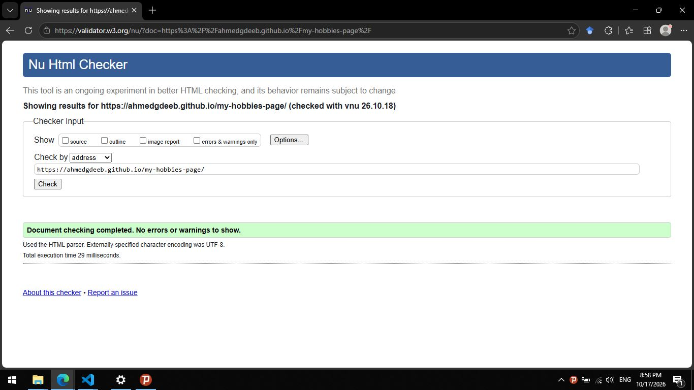
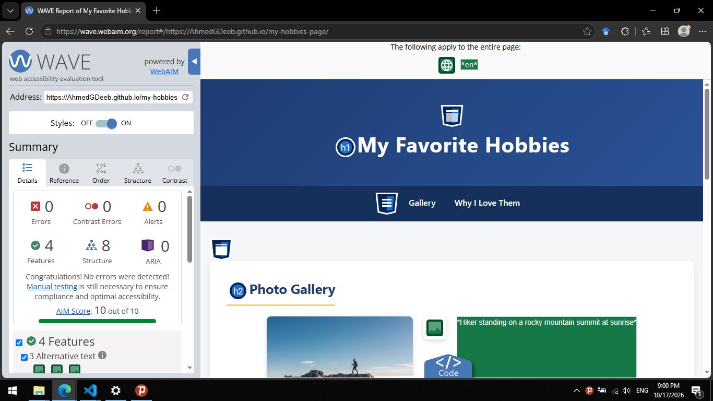

# Web Design for Everybody – Final Project

This repository contains my submission for the **Peer-graded Assignment: Final Project** in the Coursera specialization *Web Design for Everybody: Basics of Web Development & Coding* (University of Michigan).

## Project Topic

A single-page website about my favorite hobbies (hiking, reading, and cycling).

## Files

- `index.html` – the main (and only) HTML page
- `hiking.jpg`, `reading.jpg`, `cycling.jpg` – images used on the page

## Requirements Met

- Valid HTML5 with `<!DOCTYPE html>`, `<head>`, `<body>`, and `<title>`
- Semantic tags used: `<header>`, `<nav>`, `<main>`, `<footer>`
- Proper heading hierarchy (`h1` → `h2`, no skipped levels)
- An unordered list with three items
- Three images, each with a descriptive `alt` attribute
- One external link
- Passes the W3C Markup Validation Service with no errors
- Passes the WAVE Web Accessibility Evaluation Tool with no errors

## Live Site

View the hosted page here: **https://AhmedGDeeb.github.io/my-hobbies-page/**

## Validation

- [W3C Validation](https://validator.w3.org/nu/?doc=https%3A%2F%2Fahmedgdeeb.github.io%2Fmy-hobbies-page%2F)

- [WAVE Accessibility Check](https://wave.webaim.org/report#/https://AhmedGDeeb.github.io/my-hobbies-page/)

## Author

Ahmad Deeb – Coursera learner